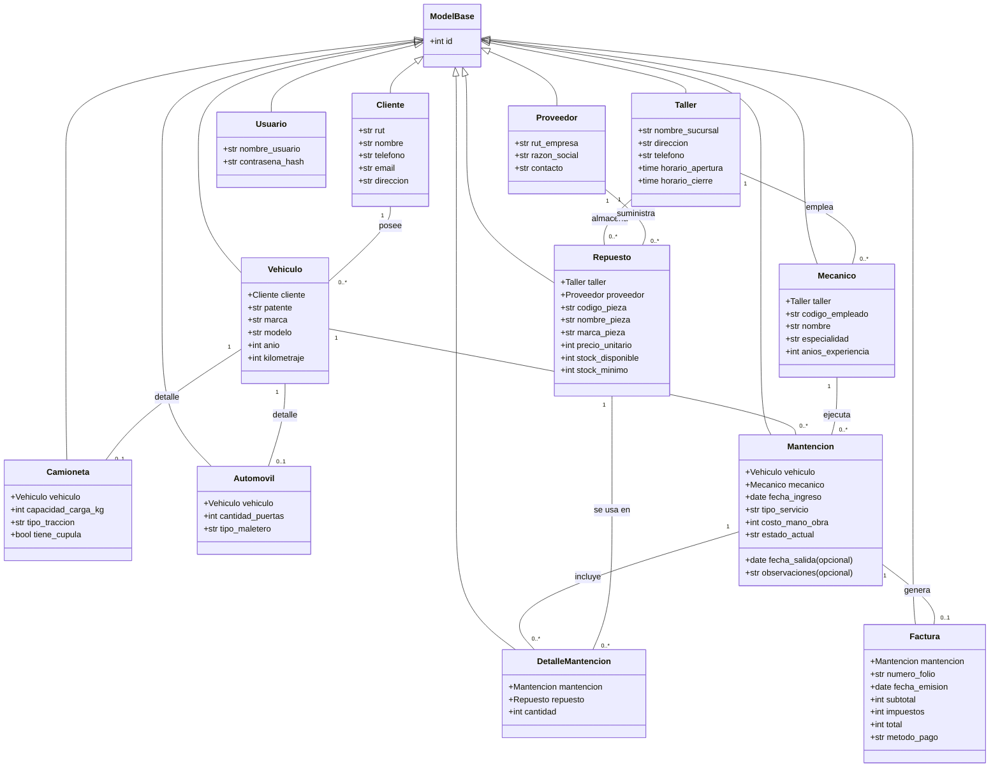

# Diagrama de clases del taller

Cada modelo hereda el identificador y la conexión de `ModelBase`. El detalle de un vehículo puede ser de automóvil o camioneta. El cliente de una factura se obtiene a través de la mantención y el vehículo. El taller que atendió al cliente se obtiene a través de la mantención y el mecánico.
